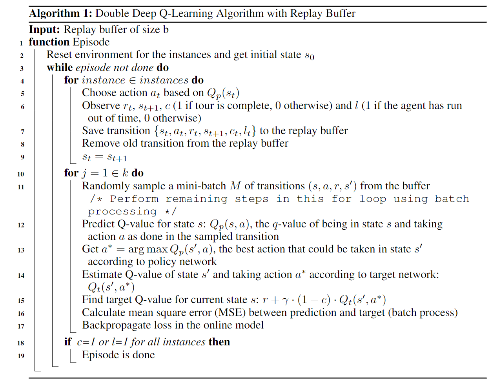
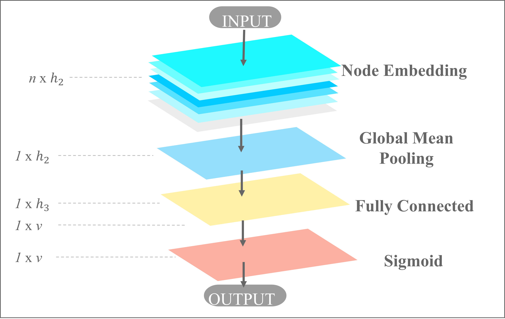
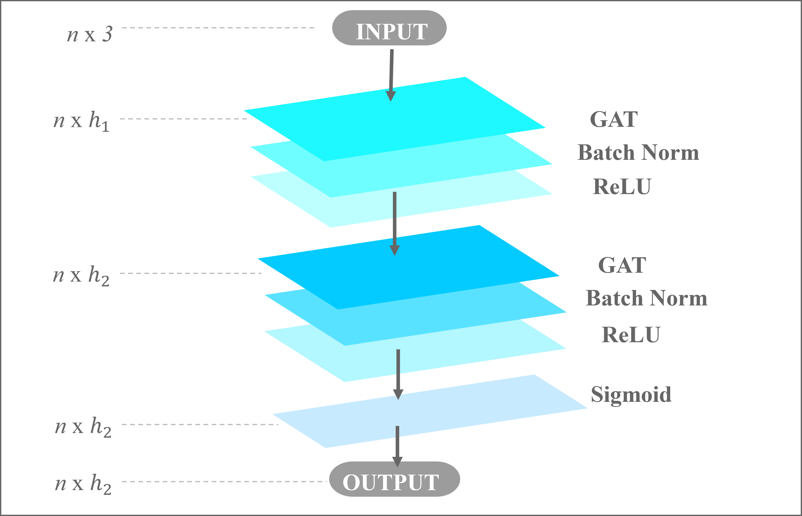

# Double-Deep Q-Learning to solve the Orienteering Problem

Completed as supervised research in Fall 2024 and submitted as final
project for IE 500: Intro to Deep Learning. Published in Fall 2026 
after documentation.

## Tech Stack
- **Languages:** Python
- **Libraries:** pytorch, pytorch-geometric, scikit-learn, scipy, matplotlib, networkx, gymnasium

## Algorithm


## Graph Neural Networks (Outer & Inner)



## Full Write-Up
For methodology, results, and design decisions, see the
[project report](docs/RL/Using_DDQN_to_Solve_the_Orienteering_Problem.pdf)

### Setup

1. Clone the repository:
```bash
   git clone https://github.com/krysc/DDQN-4-OP.git
   cd DDQN-4-TOP
```

2. Create and activate a virtual environment:
```bash
conda env create -f environment.yml
conda activate DDQL
```

## Usage
Run the project:
```bash
cd docs/RL
python train.py
```
